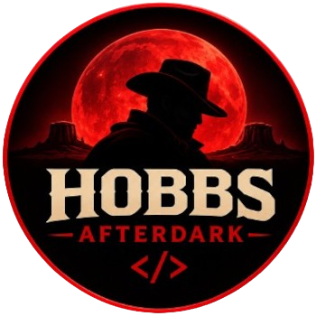

# Hobbs Afterdark

### When the world sleeps, we code.

RedM scripts for VORP servers. Lua, NUI and multiplayer systems, more than **130 original RedM resources**, built, tested and running in production.

 

 

---

## About Hobbs Afterdark

Hobbs Afterdark is the home of **The Hobbs Collection** for **RedM**, the multiplayer modification for Red Dead Redemption 2.

What gets built here are not snippets but complete systems, with server side logic, real multiplayer synchronization, persistent data and custom interfaces. They are made for servers that actually have players on them, at peak hour, doing things nobody planned for.

The name is not marketing. Most of this gets written after dark.

---

## The Store

Selected scripts from the collection are for sale at **[hobbsafterdark.com](https://hobbsafterdark.com)**. Payment and delivery run through Tebex, straight into your Cfx.re account. Escrow protected, with config, locales and UI files open. One price, updates for life, support on [Discord](https://discord.gg/bsDWuv5UPf).

Installation guides, configuration and exports for every script are in the **[documentation](https://docs.hobbsafterdark.com)**.

---

## What We Build

| Domain | Examples |
| :--- | :--- |
| **Economy and Trade** | Banking, owned shops, auction house, stock exchange, lottery, trading cards |
| **Jobs** | Farming, fishing, hunting, mining, oilfield, moonshining, beekeeping, railroad, lumberjack, wagoncraft |
| **Law and Order** | Sheriff and marshal tools, records and case files, jail, dispatch, robbery, bounty hunting |
| **Life and Roleplay** | Housing, marriage, clothing, emotes, musicians, medical care, church, memorial, telegrams |
| **World and Activities** | Archaeology, ecology, herbalism, camping, rodeo, cockfights, séances, casino and table games |
| **Foundation and Tooling** | Shared libraries, notifications, chat, prompts, admin interface, loading screen |

---

## The Hobbs Collection

Self contained gameplay systems with their own configuration, data handling, logging and interfaces, built on a shared foundation of libraries, interaction systems and interface components. Build it properly once, so everything on top is written faster, read more easily and breaks less often in ways nobody can reproduce.

Every one of these resources has met real players already. That is a different standard than a test run alone on a development server, and you can see it in the code. Anything that moves money or items is decided by the server. Whatever the client claims gets checked. And for the moment when somebody closes the game in the middle of a transaction, there is a way back to a clean state.

---

## How We Work

**Server authoritative** · **Performance conscious** · **Readable code** · **Everything configurable**

 

The server decides about money, items and world state, never the client. Loops have to justify themselves or they get removed. Every system ships with a configuration, because the next server will want it slightly different anyway. And natives get checked against the RedM reference before anyone trusts them, because RedM is not GTA V and the differences bite quietly.

---

## Technologies

---

## About This Page

The script repositories are private on purpose, access is granted per project, to the people who need it.

Looking for something specific? Browse the [store](https://hobbsafterdark.com), read the [docs](https://docs.hobbsafterdark.com) or ask on [Discord](https://discord.gg/bsDWuv5UPf).

---

### Build it, test it, optimize it, restart the server, test it again

*Because "it works on my client" is not a multiplayer test.*

 

**Hobbs Afterdark**, maintained by [@DerHobbs](https://github.com/DerHobbs)

